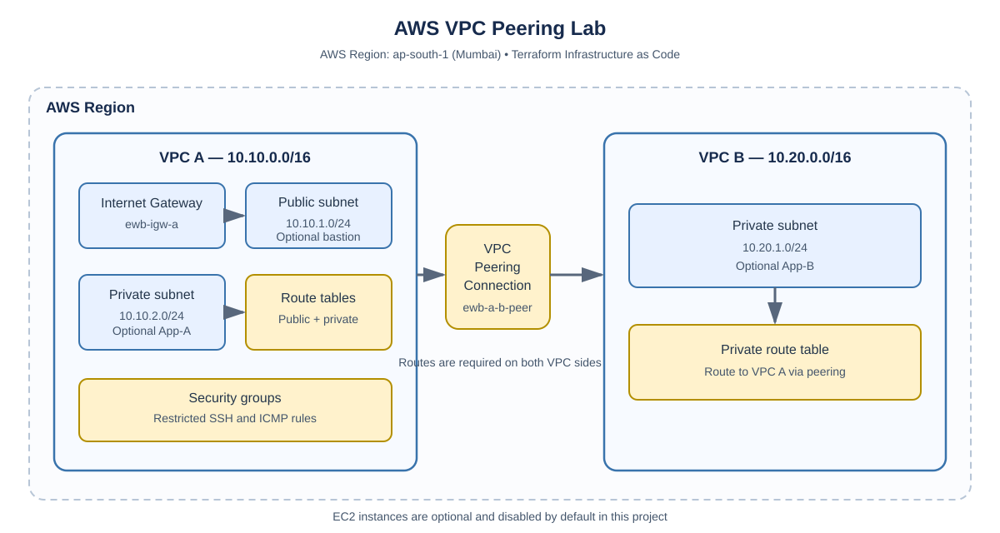

# AWS VPC Peering Lab with Terraform

A beginner-friendly Infrastructure as Code (IaC) project that defines two Amazon Virtual Private Clouds (VPCs) connected through VPC Peering in the AWS Mumbai Region (`ap-south-1`).

> **Project status:** This repository contains Terraform configuration and documentation. The infrastructure has **not** been deployed or connectivity-tested as part of preparing this repository. Do not describe the lab as deployed until you run and verify it yourself.

## Project objectives

- Create two isolated VPC networks with non-overlapping CIDR ranges.
- Connect the VPCs using a VPC Peering connection.
- Configure route tables so each VPC can route traffic to the other VPC.
- Apply security-group rules for restricted administrative access and ICMP testing.
- Manage the infrastructure using Terraform instead of creating each resource manually.
- Review the Terraform plan and clean up resources after a real deployment.

## Architecture



Editable diagram source: [`docs/architecture.mmd`](docs/architecture.mmd)

### Network plan

| Component | CIDR / setting | Purpose |
|---|---|---|
| AWS Region | `ap-south-1` (Mumbai) | Region used by the Terraform configuration |
| VPC A | `10.10.0.0/16` | First network |
| VPC A public subnet | `10.10.1.0/24` | Optional bastion subnet |
| VPC A private subnet | `10.10.2.0/24` | Optional App-A subnet |
| VPC B | `10.20.0.0/16` | Second network |
| VPC B private subnet | `10.20.1.0/24` | Optional App-B subnet |
| VPC Peering | `ewb-a-b-peer` | Private routing between the VPCs |

The CIDR ranges are non-overlapping, which is required for VPC peering.

## Services and tools

- Amazon VPC
- VPC Peering
- Subnets, route tables, and routes
- Internet Gateway for VPC A's public subnet
- Security groups
- Amazon EC2 (optional; disabled by default)
- Terraform
- AWS CLI

## Repository structure

```text
aws-vpc-peering-lab/
├── README.md
├── docs/
│   ├── architecture.mmd
│   ├── architecture.svg
│   └── validation-checklist.md
└── terraform/
    ├── main.tf
    ├── variables.tf
    ├── outputs.tf
    ├── terraform.tfvars.example
    └── .gitignore
```

## Prerequisites

For an actual deployment, you need:

1. An AWS account with permission to use VPC resources.
2. Terraform 1.5 or newer installed locally.
3. AWS CLI configured for the intended account.
4. An existing EC2 key pair and your public IPv4 CIDR only if you choose to enable EC2.

**Cost and account warning:** Do not enter payment details or upgrade an account just to publish this repository. The project can be reviewed on GitHub without deploying it. VPCs and peering generally have no direct hourly charge, but data transfer and optional resources may incur charges. EC2 instances, EBS volumes, public IPv4 addresses, and related services can cost money. Check current AWS pricing and your account's terms before deployment.

## Quick start (only if you choose to deploy)

1. Open a terminal in the repository's `terraform` directory.
2. Copy the example variables file:

   ```bash
   cp terraform.tfvars.example terraform.tfvars
   ```

   On Windows PowerShell, use:

   ```powershell
   Copy-Item terraform.tfvars.example terraform.tfvars
   ```

3. Keep `enable_ec2 = false` unless you have reviewed the costs and configured the required EC2 values.
4. Initialize Terraform and inspect the plan:

   ```bash
   terraform init
   terraform validate
   terraform plan
   ```

5. Only apply after reviewing the complete plan, permissions, account terms, and potential charges:

   ```bash
   terraform apply
   ```

Do not run `terraform apply` just to submit the GitHub repository. The network resources are created only when Terraform is run and applied.

## Optional EC2 instances

The Terraform configuration can optionally create a bastion host in VPC A's public subnet and two private application instances. EC2 is disabled by default to help avoid accidental compute charges. Before enabling it, configure the key pair and administrator CIDR, review the plan, and check AWS pricing.

Private instances are not assigned public IPv4 addresses by this configuration. Do not open SSH access to `0.0.0.0/0`.

## Validation checklist

After a real deployment, use [`docs/validation-checklist.md`](docs/validation-checklist.md) to check the VPCs, peering status, route tables, security groups, and connectivity. Record actual results and screenshots only after performing the checks.

## Cleanup

If you deployed the resources using Terraform, review and run:

```bash
terraform destroy
```

Confirm the destroy plan before proceeding. Also check the AWS Console for any resources created manually outside Terraform.

## Learning outcomes

After completing and validating the lab, a learner should be able to explain:

- Why two VPCs need non-overlapping CIDR blocks for peering.
- How a peering connection differs from a route.
- Why routes must be configured on both sides.
- How security groups control permitted traffic.
- How Terraform supports repeatable infrastructure changes and cleanup.

## Limitations

- This repository is an Infrastructure as Code lab, not evidence of a successful deployment.
- No connectivity result is claimed until the lab is deployed and tested.
- EC2 instances are optional and disabled by default.
- AWS pricing and account eligibility may vary; verify them before deploying.

## Author

**Sonu P. Balagavi**

GitHub: [sonu-balagavi15](https://github.com/sonu-balagavi15)
