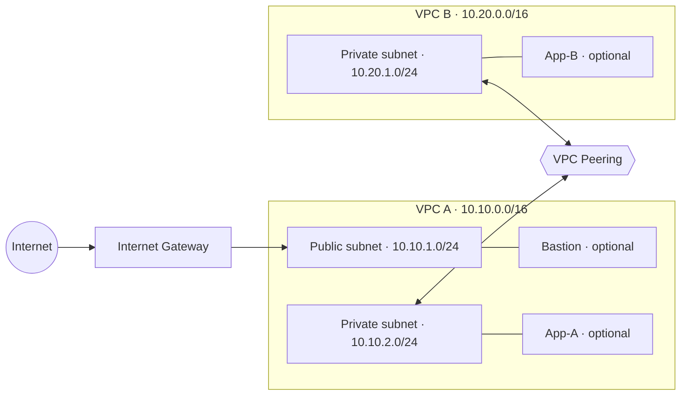

# AWS VPC Peering Lab (Terraform)

A reproducible Infrastructure-as-Code implementation of a two-VPC AWS peering lab in `ap-south-1` (Mumbai).

> **Cost and account warning:** This repository does not create AWS resources until you run Terraform. VPCs and peering have no direct hourly charge, but EC2 instances, EBS volumes, public IPv4 addresses, data transfer, and other resources may incur charges. Keep `enable_ec2 = false` until you have verified your account plan, credits, and expected charges. Do not upgrade to a paid plan unless you deliberately choose to.

## Architecture

- **VPC A** `10.10.0.0/16`
  - Public subnet `10.10.1.0/24` (optional bastion)
  - Private subnet `10.10.2.0/24` (optional App-A)
  - Internet Gateway for the public subnet
- **VPC B** `10.20.0.0/16`
  - Private subnet `10.20.1.0/24` (optional App-B)
- VPC peering connection between VPC A and VPC B
- Routes to the remote VPC CIDR via the peering connection
- Security groups that restrict SSH to the administrator CIDR and bastion, and allow ICMP only between the two app hosts



## Prerequisites

- An AWS account with access to VPC and (if enabling compute) EC2
- Terraform 1.5 or newer
- AWS CLI configured for the intended account and region
- If enabling EC2, an existing EC2 key pair in `ap-south-1` and your public IPv4 CIDR (for example, `203.0.113.10/32`; replace with your real public IP CIDR)

## Quick start

1. Change into the Terraform folder:
   ```bash
   cd terraform
   ```
2. Create your local variables file:
   ```bash
   cp terraform.tfvars.example terraform.tfvars
   ```
3. Edit `terraform.tfvars`:
   - Keep `enable_ec2 = false` while checking cost/access.
   - Set `key_name` to an existing key pair name only if you plan to enable EC2.
   - Set `admin_cidr` to your public IPv4 address with `/32` only if enabling the bastion.
4. Initialize and review the plan:
   ```bash
   terraform init
   terraform plan
   ```
5. Apply only after reviewing the plan and any potential charges:
   ```bash
   terraform apply
   ```

### Optional EC2 instances

To include the bastion, App-A, and App-B, set `enable_ec2 = true` in `terraform.tfvars` and set `key_name` and `admin_cidr` first. Review the Terraform plan and AWS pricing before applying. The optional instances use the latest Amazon Linux 2023 AMI published through AWS Systems Manager Parameter Store.

The private instances have no public IPv4 address. No SSH or ICMP rule is opened to `0.0.0.0/0`.

## Validation

With EC2 enabled and the instances running, use SSH from the administrator machine to the bastion, then from the bastion to App-A/App-B using the private IPs. Verify ICMP between App-A (`10.10.2.10`) and App-B (`10.20.1.10`) after peering routes are active. Amazon Linux may need ICMP/ping utilities available; no package installation is performed by this Terraform configuration.

## Cleanup

Remove resources created by this project as soon as you have captured your evidence:

```bash
terraform destroy
```

Review the destroy plan and confirm. Also check the EC2 console for any resources created manually outside Terraform.

## Repository structure

- `terraform/main.tf` — VPCs, subnets, IGW, peering, routes, security groups, optional EC2
- `terraform/variables.tf` — configurable values
- `terraform/outputs.tf` — network IDs and optional instance addresses
- `terraform/terraform.tfvars.example` — safe example values
- `docs/validation-checklist.md` — evidence checklist

## Limitations

This repository is Infrastructure as Code, not proof that the resources have been deployed. Do not claim that AWS connectivity tests passed until you have actually deployed and run them. The default configuration creates the network resources only; EC2 resources are disabled by default to reduce accidental costs.
